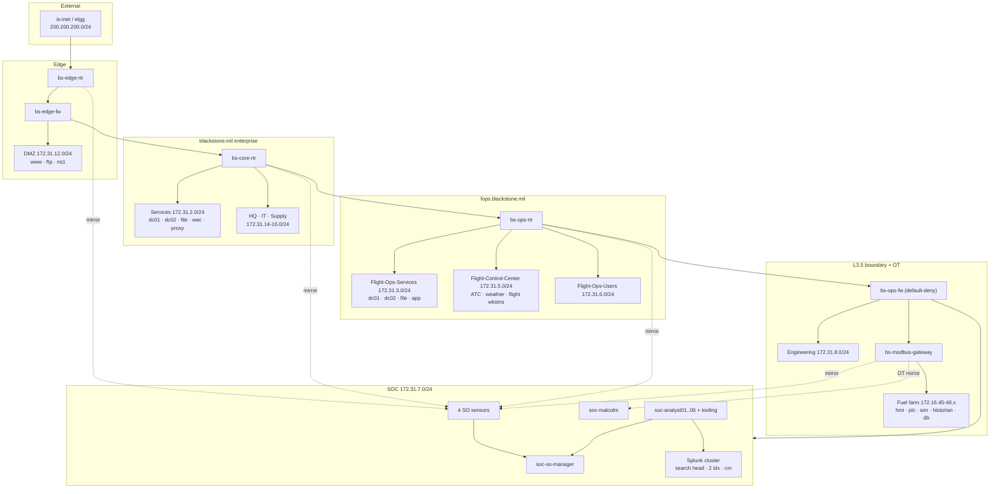

# Blackstone Auxiliary Field — Range Reference

Technical reference for the `blackstone.mil` military-airfield range: topology,
telemetry coverage, deployment procedure and verification.

Audience: event coordinators and range operators. Assumes working knowledge of
Security Onion, Splunk, Active Directory, Ansible, and the SimSpace platform.

Scope: this document covers the range. It runs two SIEMs side by side — a
distributed Security Onion grid and a distributed Splunk cluster — plus a
Malcolm appliance for OT deep-packet analysis. Endpoints feed both SIEMs; the
host and device log sources reach both as well.

---

## At a glance

| | |
|---|---|
| **Hosts** | 89 |
| **AD forest** | one forest, two domains — `blackstone.mil` (root) and child `fops.blackstone.mil`; four domain controllers, 44 domain members |
| **Enterprise segments** | Services, Headquarters, IT, Supply (blackstone.mil); DMZ |
| **Flight-ops segments** | Flight-Ops-Services, Flight-Control-Center, Flight-Ops-Users (fops.blackstone.mil) |
| **OT enclave** | Fuel farm behind a dedicated L3.5 boundary — control-room HMI, OpenPLC, field simulator, in-enclave historian and audit DB |
| **Bespoke subsystems** | Air-traffic control (radar/ADS-B replay + controller position) and recorded weather on the Flight-Control-Center |
| **SIEM** | Two, side by side — Security Onion 2.4 distributed (manager, search node, four sensors) and a distributed Splunk cluster (search head, two indexers, cluster manager) |
| **Network visibility** | Four GRE `gretap` mirrors covering enterprise, flight-ops, OT and the attack path |
| **OT deep-packet analysis** | Malcolm (CISA) on the SOC segment — the fuel-farm process segments are mirrored to it for ICS-protocol parsing in addition to Security Onion |
| **Endpoint visibility** | Elastic Agent (into SO's Fleet) and a Splunk universal forwarder on every managed host — both SIEMs see endpoints |
| **Device log sources** | pfSense ×2 and VyOS ×5, aggregated on `soc-syslog`, parsed into Security Onion and forwarded to Splunk |
| **Analyst positions** | Six FLARE-imaged analyst workstations plus SIFT and OpenVAS tooling on the SOC segment |
| **User activity** | Emulated users generating background traffic across the enterprise and flight-ops segments |

---

## Design constraints

Four properties of the build determine what practitioners can and cannot see.

**Sensor coverage is positional.** Each sensor receives a mirror from exactly
one router, so an event is visible only to the sensor whose router carries it.
Enterprise traffic reaches `soc-sensor-corp`; flight-ops reaches
`soc-sensor-fops`; fuel-farm OT reaches `soc-sensor-ot`; the attack path and
simulated Internet reach `soc-sensor-edge`. There is no aggregation tap.

**The OT enclave is segmented at layer 3.** `bs-ops-fw` is a default-deny L3.5
boundary and `bs-modbus-gateway` is the single routed path into the fuel-farm
Purdue segments. OT reaches the enterprise over static routes only.

**Endpoint telemetry follows the Purdue level, not the subnet.** The OT hosts
that *run* the process — the HMI, the PLC, the field simulator — carry no
endpoint agent; the hosts that *monitor* it — the historian and audit DB — do.

**The network is not quiet.** Emulated users generate browsing, file and process
activity continuously across the enterprise and flight-ops segments. Detection
logic that depends on a low-noise baseline will not behave as it does in a lab.

---

## Network architecture



### Segments

| Segment | CIDR | Domain | Contents |
|---|---|---|---|
| DMZ | 172.31.12.0/24 | — | `bs-ftp`, `bs-www`, `bs-ns1` |
| Services | 172.31.2.0/24 | blackstone.mil | `bs-dc01`, `bs-dc02`, `bs-file01/02`, `bs-wec`, `bs-proxy` |
| Headquarters | 172.31.14.0/24 | blackstone.mil | 6 workstations |
| IT | 172.31.15.0/24 | blackstone.mil | 5 workstations |
| Supply | 172.31.16.0/24 | blackstone.mil | 5 workstations |
| Flight-Ops-Services | 172.31.3.0/24 | fops.blackstone.mil | `fops-dc01/02`, `fops-file01/02`, `fops-wec01`, `fops-app01..03` |
| Flight-Control-Center | 172.31.5.0/24 | fops.blackstone.mil | `atc-radar`, `atc-weather`, `atc-station`, `fops-flight01..04` |
| Flight-Ops-Users | 172.31.6.0/24 | fops.blackstone.mil | 8 workstations |
| Engineering | 172.31.8.0/24 | blackstone.mil (Win) | `bs-eng01..06`, `bs-ro-hist` |
| SOC | 172.31.7.0/24 | — | SO grid, Splunk cluster, Malcolm, 6 analyst workstations, SIFT/OpenVAS, syslog collector |
| OT · MTU | 172.16.45.0/29 | — | `control-room-hmi` (FUXA) |
| OT · Fuel-Farm PLC | 172.16.45.8/29 | — | `ff-plc-1` (OpenPLC) |
| OT · Fuel-Farm Sim | 172.16.46.0/24 | — | `fuel-farm-sim`, `fuel-hist`, `fuel-db` |
| Internet (sim) | 200.200.200.0/24 | — | `is-inet`, `elgg` |

### Routing

| Domain | Protocol | Notes |
|---|---|---|
| Enterprise + flight-ops core | OSPF area 0 | `bs-core-rtr`, `bs-ops-rtr`, `bs-sec-rtr` and both pfSense firewalls |
| ISP edge | eBGP | `bs-edge-rtr` (AS 65002) ↔ `bs-edge-fw` (AS 65001) — the only BGP session in the fabric |
| L3.5 OT boundary | Static, default-deny | `bs-ops-fw` ↔ `bs-modbus-gateway` is static-only; the OT umbrella `172.16.0.0/16` is a static route redistributed into OSPF |

---

## Active Directory

One forest, two domains, four domain controllers:

| DC | Address | Domain | Placement |
|---|---|---|---|
| `bs-dc01` | 172.31.2.7 | blackstone.mil | Primary (forest root) |
| `bs-dc02` | 172.31.2.8 | blackstone.mil | Additional |
| `fops-dc01` | 172.31.3.11 | fops.blackstone.mil | Primary (child) |
| `fops-dc02` | 172.31.3.12 | fops.blackstone.mil | Additional |

`fops.blackstone.mil` is a **child domain** of `blackstone.mil` in a single
forest, so the parent/child trust is automatic, bidirectional and transitive.
44 hosts are domain members (29 on `blackstone.mil`, 15 on
`fops.blackstone.mil`); every Windows VM is joined. Workstations run **emulated
users** with realistic identities. `is-inet` hosts mailboxes for both domains.

---

## The OT enclave — fuel farm

The fuel farm is a Purdue-style chain behind the `bs-ops-fw` L3.5 boundary,
reached only through `bs-modbus-gateway`:

| Host | Address | Role |
|---|---|---|
| `control-room-hmi` | 172.16.45.3 | FUXA operator console (MTU / Level 2) |
| `ff-plc-1` | 172.16.45.10 | OpenPLC v4 controller (Level 1) — Modbus TCP `:502` |
| `fuel-farm-sim` | 172.16.46.17 | pymodbus field simulation (Level 0/1) |
| `fuel-hist` | 172.16.46.18 | Historian — Telegraf + InfluxDB 2.7 + Grafana (Level 3) |
| `fuel-db` | 172.16.46.19 | Audit DB — PostgreSQL 16 + TimescaleDB (Level 3) |

The HMI, PLC and field simulator carry **no endpoint agent** — they run the
process. Only the Level 3 historian and audit DB are agent targets.
`soc-sensor-ot` mirrors all three OT segments, and Malcolm additionally parses
the ICS protocols on them (see below). The FUXA image ships without the Modbus
driver, so the deploy installs `modbus-serial` into the container from the
in-platform Nexus npm group through the management proxy. The fuel farm deploys
from `fuel_farm_playbook.yml` and is checked by `verify_fuel_farm.sh`.

---

## The ATC subsystem

On the Flight-Control-Center segment (`172.31.5.0/24`, `fops.blackstone.mil`):

| Host | Address | Role |
|---|---|---|
| `atc-radar` | 172.31.5.10 | ADS-B / radar replay backend feeding the scope |
| `atc-weather` | 172.31.5.11 | Recorded-weather feed |
| `atc-station` | 172.31.5.12 | Controller working position / display |

Four flight display workstations (`fops-flight01..04`) consume the display. The
subsystem deploys from `atc_playbook.yml` and is checked by `verify_atc.sh`.

---

## Security Onion

Distributed 2.4 grid on the SOC segment:

| Node | Address | Role |
|---|---|---|
| `soc-so-manager` | 172.31.7.15 | Manager, SOC web interface, Fleet |
| `soc-so-search` | 172.31.7.20 | Search node |
| `soc-sensor-corp` | 172.31.7.21 | Enterprise traffic |
| `soc-sensor-fops` | 172.31.7.22 | Flight-ops traffic |
| `soc-sensor-ot` | 172.31.7.23 | Fuel-farm OT traffic |
| `soc-sensor-edge` | 172.31.7.24 | Attack path and Internet |

### Splunk

A distributed Splunk cluster runs on the SOC segment alongside the Security
Onion grid — a second, independent SIEM over the same estate:

| Node | Address | Role |
|---|---|---|
| `soc-splunk` | 172.31.7.25 | Search head (analyst-facing) |
| `soc-splunk-idx01` | 172.31.7.26 | Indexer (cluster peer, label `mb-idxc`) |
| `soc-splunk-idx02` | 172.31.7.27 | Indexer (cluster peer, label `mb-idxc`) |
| `soc-splunk-cm` | 172.31.7.28 | Cluster manager + license manager |

A universal forwarder on every managed host ships Windows event logs and Sysmon,
Linux syslog and service logs, and the device syslog aggregated on `soc-syslog`
to the indexers — in parallel with, and independent of, the Elastic Agent path
into Security Onion. The same sources feed both, so a cohort can work either
platform over identical activity; a gap in one is not a gap in the other. The
Splunk cluster hosts are themselves Elastic-Agent targets, with a path-scoped
Defend exclusion for `/opt/splunk/var` so their own bucket churn does not swamp
the dataset. A post-deploy check (`splunk-verify-user`) proves a user can
actually log in and search.

### Mirror implementation

Traffic is copied from router interfaces into `gretap` tunnels with `tc mirred`.

| Property | Value |
|---|---|
| Encapsulation | `gretap` (layer 2) — a layer-3 `gre` tunnel yields `DLT_RAW` and produces zero connection logs while Suricata continues to alert |
| Tunnel MTU | 1500 — raised above the kernel's 1462 `gretap` default; routers clamp TCP MSS to keep mirrored frames within the routed underlay |
| Mechanism | `tc` ingress + root `prio` qdiscs per source interface. On `bs-modbus-gateway` the OT process interfaces fan out to a second tunnel feeding Malcolm |
| Persistence | re-applied from the VyOS post-config boot script |
| Exclusions | `10.255.240.0/20` passed ahead of the mirror catch-all |

| Sensor | Mirrors | Coverage |
|---|---|---|
| `soc-sensor-corp` | `bs-core-rtr` | Services, Headquarters, IT, Supply |
| `soc-sensor-fops` | `bs-ops-rtr` | Flight-Ops-Services, Flight-Control-Center, Flight-Ops-Users |
| `soc-sensor-ot` | `bs-modbus-gateway` | MTU, Fuel-Farm PLC, Fuel-Farm Sim |
| `soc-sensor-edge` | `bs-edge-rtr` | simulated Internet and the edge transit |

Sensor identity is a location signal: an event present on `soc-sensor-ot` and
absent from `soc-sensor-fops` did not cross the OT boundary. Verify a mirror with
the absolute path — `tc` is not on the `vyos` user's PATH:
`/sbin/tc filter show dev eth1 ingress`.

### Endpoint telemetry

Every managed endpoint carries **two** agents: an Elastic Agent enrolled into
SO's Fleet, and a Splunk universal forwarder shipping to the indexer cluster.
Process and file activity therefore sits alongside network evidence in Security
Onion and is searchable in Splunk at the same time; the two paths are
independent. Elastic Agent covers 66 endpoints (every Windows and Linux host
except the SO grid and the three OT process hosts). **Sysmon runs across the
whole Windows fleet (48 hosts)**, and both agents pick it up.

### Device log sources

The firewalls and routers cannot run an agent or a forwarder, so `soc-syslog` is
the central rsyslog collector. Both SIEMs consume it: the Security Onion Fleet
integrations parse the stored copies, and the Splunk universal forwarder on
`soc-syslog` ships them to the indexers.

| Source | Into Security Onion | Into Splunk |
|---|---|---|
| pfSense ×2 | per-firewall loopback relay (`bs-edge-fw` → 9001, `bs-ops-fw` → 9002) parsed by the Elastic pfSense integration | forwarder on `soc-syslog` ships the stored copy |
| VyOS ×5 | agent tails `/var/log/remote/<router>/syslog.log`, enumerated per router | forwarder on `soc-syslog` ships the stored copy |

### Access

SOC web interface: **`https://172.31.7.15`**, admin `admin@blackstone.mil`.
Splunk search head: **`soc-splunk` (172.31.7.25)**. Reach both from an analyst
workstation; SOC is configured for IP access, so there is no hostname to resolve.

---

## Malcolm — OT deep-packet analysis

`soc-malcolm` (`172.31.7.30`, SOC segment) is a CISA Malcolm appliance dedicated
to the fuel-farm enclave. Security Onion sees the same OT traffic on
`soc-sensor-ot`; Malcolm adds the ICS protocol parsers that make process traffic
legible.

| Property | Value |
|---|---|
| Host | `soc-malcolm`, SOC `172.31.7.30` |
| Stack | Malcolm 26.08.0 (OpenSearch, Arkime, Zeek, Suricata, Logstash) under Docker |
| Capture | live on `otmir0` — an IP-less `gretap` decap interface |
| Feed | a second `gretap` tunnel (`tun1`) fanned out from `bs-modbus-gateway`, carrying the fuel-farm process segments |
| Web UI | `https://172.31.7.30` |

The appliance is not in `[linux]`, so the base baseline never runs against it;
the Malcolm phase owns its whole configuration. Images are pulled from the Nexus
docker registry and retagged locally to their `ghcr.io` names (the compose
greps for those names during keystore creation). The tunnel is receive-only.

---

## The analyst environment

Six FLARE-imaged analyst workstations on the SOC segment — `soc-analyst01..06`
(`172.31.7.31–.36`) — carry the Windows reverse-engineering and malware-analysis
toolset at the hunt position itself. The forensic bench alongside:

| Host | Address | Purpose |
|---|---|---|
| `soc-sift` | mgmt-only | SANS Investigative Forensic Toolkit — disk and memory analysis |
| `soc-openvas` | 172.31.7.16 | Vulnerability scanning |

> **Adjacency — read before running live samples.** The SOC segment is not a
> mirror source, so no sensor captures traffic between the analyst hosts and the
> SIEMs. A worm-like sample shares layer 2 with the grid and reaches it without
> traversing a router. This is acceptable for static analysis; uncontrolled
> detonation needs a dedicated analysis subnet with no path to the SOC segment.

---

## Standing the range up

```
cd /etc/ansible
wget -q -O airfield_full_stack.tgz <tarball URL for the pinned commit>
tar -xzf airfield_full_stack.tgz
sudo ./deploy.sh
```

`deploy.sh` makes three attempts: a full run, then failed hosts only, then a
full run again. A first-attempt failure is often ordering rather than fault —
attempt 3 is the confirmation. Expect **two to three hours** for a full build
from a fresh blueprint.

### Where the install artifacts come from

The build pulls its install media from the in-platform Nexus
(`nexus.dev.ng.simspace.lan`), reached through the management proxy
(`10.255.240.1:3128`):

| Artifact | Nexus repo |
|---|---|
| Security Onion source snapshot and airgap content | `ng_raw` (`installers/so/…`) |
| Security Onion and Malcolm container images | `nexus-docker` |
| Malcolm 26.08.0 source | `ng_raw` (`installers/malcolm/…`) |
| Ansible Galaxy collections | `ng_raw/galaxy` |
| Fuel-farm Python packages | `ng_pypi` |
| HMI `modbus-serial` npm closure | `npm` group |
| Splunk packages | `ng_raw` |

apt is the exception: base packages and `docker-ce` install from the Ubuntu
archive and `download.docker.com` through the proxy. Nexus presents an
internal-CA certificate, so each fetcher that reaches it is configured to trust
or skip-verify that host specifically.

### Verifying

```
sudo ./verify_deployment.sh     # range-wide
sudo ./verify_fuel_farm.sh      # fuel-farm OT acceptance
sudo ./verify_atc.sh            # ATC subsystem
```

The Security Onion grid is verified inside the deploy by the `60-verify` phase.
Confirm the sensors are *seeing traffic*:

```
sudo ansible soc-sensor-corp,soc-sensor-fops,soc-sensor-ot,soc-sensor-edge -b -m shell \
  -a 'timeout 10 tcpdump -i tun0 -c 20 2>&1 | tail -3'
```

For Splunk, confirm cluster health from the manager and that the search head can
search:

```
ssh soc-splunk-cm "sudo /opt/splunk/bin/splunk show cluster-status -auth <user>:<pw>"
ansible splunk_search_head -m shell -a 'sudo /opt/splunk/bin/splunk status'
```

---

## What healthy looks like

| Check | Expected |
|---|---|
| `so-status` on every SO node | all services running |
| Elastic cluster | green, search node present |
| Splunk cluster | indexers up, search/replication factors met |
| `tcpdump -i tun0` on each sensor | packets flowing |
| Zeek `conn.log` | connection records, not zero |
| Fleet | every endpoint enrolled; forwarders reporting to the indexers |
| Domain membership | 44 members joined across the two domains |
| Fuel farm / ATC | `verify_fuel_farm.sh` / `verify_atc.sh` clean |

---

## Known behaviours

**SOC health-check failures fetching detection content.** The range runs in
airgap mode, so SO's periodic content fetches fail continuously. Detection on
ingested data is unaffected.

**Gateway ARP repair messages during deploy.** The `init` role catches and
corrects a platform-level gateway-ARP fault before it can break routing.

**Emulated user noise.** Continuous activity across the workstation fleet is
intentional.

**The L3.5 boundary permits everything today.** `bs-ops-fw` carries lab "allow
any" rules; a cross-boundary reachability test that succeeds is expected for now.

---

## Credentials

> The current range default credentials are configured in `group_vars` (the
> Security Onion, OT and Malcolm secrets in `group_vars/all/vault.yml`, Ansible
> Vault; the OS/device connection accounts and the Splunk accounts in the
> per-group/`all` files). The password values are omitted here because this
> repository is public. **Rotate all defaults before any deployment that is not
> a lab.**

| System | Access | Username | Password |
|---|---|---|---|
| Security Onion SOC | `https://172.31.7.15` | `admin@blackstone.mil` | (vault) |
| Splunk | search head `172.31.7.25` | `admin` | (see `group_vars`) |
| Malcolm | `https://172.31.7.30` | `xadmin` | (vault) |
| Domain admin | both domains | `xadmin` | (see `group_vars`) |
| Domain users | both domains | seeded identities | (see `group_vars`) |
| Windows hosts | RDP / WinRM | `xadmin` | (see `group_vars`) |
| Linux hosts | SSH | `simspace` | (see `group_vars`) |
| Ubuntu Desktop 25 (Engineering Linux) | SSH / console | `xadmin` | (see `group_vars`) |
| pfSense firewalls | SSH / web | `admin` | (see `group_vars`) |
| VyOS routers | SSH | `vyos` | (see `group_vars`) |
| OpenPLC / FUXA / InfluxDB / fuel audit DB | OT | role accounts | (vault) |
| SO node join secret | — | — | (vault) |

This variant is built on the 1.2.x platform images, whose Windows and Ubuntu
Desktop local admin is `xadmin`. Using the wrong account for the image
generation does not fail fast; it retries until timeout and looks like an
unbooted host.

---

## Appendix — full host inventory

| Host | Address | Segment | Function |
|---|---|---|---|
| `ansible` | 10.10.10.10 | — | Ansible controller |
| `atc-radar` | 172.31.5.10 | Flight-Control-Center (fops) | ATC subsystem |
| `atc-station` | 172.31.5.12 | Flight-Control-Center (fops) | ATC subsystem |
| `atc-weather` | 172.31.5.11 | Flight-Control-Center (fops) | ATC subsystem |
| `bs-core-rtr` | 172.31.1.6 | transit | VyOS router |
| `bs-dc01` | 172.31.2.7 | Services (blackstone.mil) | domain controller (primary) |
| `bs-dc02` | 172.31.2.8 | Services (blackstone.mil) | domain controller (additional) |
| `bs-edge-fw` | 199.252.163.1 | edge transit | pfSense firewall |
| `bs-edge-rtr` | 200.200.200.1 | Internet (sim) | VyOS router (ISP edge) |
| `bs-eng01` | 172.31.8.11 | Engineering | engineering workstation |
| `bs-eng02` | 172.31.8.12 | Engineering | engineering workstation |
| `bs-eng03` | 172.31.8.13 | Engineering | engineering workstation |
| `bs-eng04` | 172.31.8.14 | Engineering | engineering workstation |
| `bs-eng05` | 172.31.8.15 | Engineering | engineering workstation (Linux) |
| `bs-eng06` | 172.31.8.16 | Engineering | engineering workstation (Linux) |
| `bs-file01` | 172.31.2.10 | Services (blackstone.mil) | file server |
| `bs-file02` | 172.31.2.11 | Services (blackstone.mil) | file server |
| `bs-ftp` | 172.31.12.2 | DMZ | DMZ service (ftp) |
| `bs-hq01` | 172.31.14.11 | Headquarters | HQ workstation |
| `bs-hq02` | 172.31.14.12 | Headquarters | HQ workstation |
| `bs-hq03` | 172.31.14.13 | Headquarters | HQ workstation |
| `bs-hq04` | 172.31.14.14 | Headquarters | HQ workstation |
| `bs-hq05` | 172.31.14.15 | Headquarters | HQ workstation |
| `bs-hq06` | 172.31.14.16 | Headquarters | HQ workstation |
| `bs-it01` | 172.31.15.11 | IT | IT workstation |
| `bs-it02` | 172.31.15.12 | IT | IT workstation |
| `bs-it03` | 172.31.15.13 | IT | IT workstation |
| `bs-it04` | 172.31.15.14 | IT | IT workstation |
| `bs-it05` | 172.31.15.15 | IT | IT workstation |
| `bs-modbus-gateway` | 172.31.1.18 | transit / OT head | VyOS router |
| `bs-ns1` | 172.31.12.5 | DMZ | DMZ service (DNS) |
| `bs-ops-fw` | 172.31.1.14 | transit | pfSense firewall (L3.5 boundary) |
| `bs-ops-rtr` | 172.31.1.10 | transit | VyOS router |
| `bs-proxy` | 172.31.2.15 | Services (blackstone.mil) | proxy (squid) |
| `bs-ro-hist` | 172.31.8.5 | Engineering | read-only historian replica |
| `bs-sec-rtr` | 172.31.1.22 | transit | VyOS router |
| `bs-supply01` | 172.31.16.11 | Supply | supply workstation |
| `bs-supply02` | 172.31.16.12 | Supply | supply workstation |
| `bs-supply03` | 172.31.16.13 | Supply | supply workstation |
| `bs-supply04` | 172.31.16.14 | Supply | supply workstation |
| `bs-supply05` | 172.31.16.15 | Supply | supply workstation |
| `bs-wec` | 172.31.2.17 | Services (blackstone.mil) | Windows Event Collector |
| `bs-www` | 172.31.12.3 | DMZ | DMZ service (web) |
| `control-room-hmi` | 172.16.45.3 | OT · MTU | control-room HMI (FUXA), OT bridge |
| `elgg` | — | Internet (sim) | scenario host |
| `ff-plc-1` | 172.16.45.10 | OT · Fuel PLC | OpenPLC controller |
| `fops-app01` | 172.31.3.30 | Flight-Ops-Services (fops) | flight-ops app server |
| `fops-app02` | 172.31.3.31 | Flight-Ops-Services (fops) | flight-ops app server |
| `fops-app03` | 172.31.3.32 | Flight-Ops-Services (fops) | flight-ops app server |
| `fops-dc01` | 172.31.3.11 | Flight-Ops-Services (fops) | domain controller (primary, child) |
| `fops-dc02` | 172.31.3.12 | Flight-Ops-Services (fops) | domain controller (additional) |
| `fops-file01` | 172.31.3.15 | Flight-Ops-Services (fops) | file server |
| `fops-file02` | 172.31.3.16 | Flight-Ops-Services (fops) | file server |
| `fops-flight01` | 172.31.5.81 | Flight-Control-Center (fops) | ATC display workstation |
| `fops-flight02` | 172.31.5.82 | Flight-Control-Center (fops) | ATC display workstation |
| `fops-flight03` | 172.31.5.83 | Flight-Control-Center (fops) | ATC display workstation |
| `fops-flight04` | 172.31.5.84 | Flight-Control-Center (fops) | ATC display workstation |
| `fops-ops01` | 172.31.6.11 | Flight-Ops-Users (fops) | flight-ops workstation |
| `fops-ops02` | 172.31.6.12 | Flight-Ops-Users (fops) | flight-ops workstation |
| `fops-ops03` | 172.31.6.13 | Flight-Ops-Users (fops) | flight-ops workstation |
| `fops-ops04` | 172.31.6.14 | Flight-Ops-Users (fops) | flight-ops workstation |
| `fops-ops05` | 172.31.6.15 | Flight-Ops-Users (fops) | flight-ops workstation |
| `fops-ops06` | 172.31.6.16 | Flight-Ops-Users (fops) | flight-ops workstation |
| `fops-ops07` | 172.31.6.17 | Flight-Ops-Users (fops) | flight-ops workstation |
| `fops-ops08` | 172.31.6.18 | Flight-Ops-Users (fops) | flight-ops workstation |
| `fops-wec01` | 172.31.3.20 | Flight-Ops-Services (fops) | Windows Event Collector |
| `fuel-db` | 172.16.46.19 | OT · Fuel Sim | audit DB (PostgreSQL/TimescaleDB) |
| `fuel-farm-sim` | 172.16.46.17 | OT · Fuel Sim | field simulation (pymodbus) |
| `fuel-hist` | 172.16.46.18 | OT · Fuel Sim | historian (InfluxDB/Telegraf/Grafana) |
| `is-inet` | 200.200.200.2 | Internet (sim) | mail + internet-sim DNS |
| `soc-analyst01` | 172.31.7.31 | SOC | analyst workstation (FLARE) |
| `soc-analyst02` | 172.31.7.32 | SOC | analyst workstation (FLARE) |
| `soc-analyst03` | 172.31.7.33 | SOC | analyst workstation (FLARE) |
| `soc-analyst04` | 172.31.7.34 | SOC | analyst workstation (FLARE) |
| `soc-analyst05` | 172.31.7.35 | SOC | analyst workstation (FLARE) |
| `soc-analyst06` | 172.31.7.36 | SOC | analyst workstation (FLARE) |
| `soc-malcolm` | 172.31.7.30 | SOC | Malcolm (OT deep-packet analysis) |
| `soc-openvas` | 172.31.7.16 | SOC | vulnerability scanner |
| `soc-sensor-corp` | 172.31.7.21 | SOC | Security Onion sensor |
| `soc-sensor-edge` | 172.31.7.24 | SOC | Security Onion sensor |
| `soc-sensor-fops` | 172.31.7.22 | SOC | Security Onion sensor |
| `soc-sensor-ot` | 172.31.7.23 | SOC | Security Onion sensor |
| `soc-sift` | — | SOC (mgmt) | SIFT forensic workstation |
| `soc-so-manager` | 172.31.7.15 | SOC | Security Onion manager |
| `soc-so-search` | 172.31.7.20 | SOC | Security Onion search node |
| `soc-splunk` | 172.31.7.25 | SOC | Splunk search head |
| `soc-splunk-cm` | 172.31.7.28 | SOC | Splunk cluster + license manager |
| `soc-splunk-idx01` | 172.31.7.26 | SOC | Splunk indexer |
| `soc-splunk-idx02` | 172.31.7.27 | SOC | Splunk indexer |
| `soc-syslog` | 172.31.7.13 | SOC | syslog collector |
